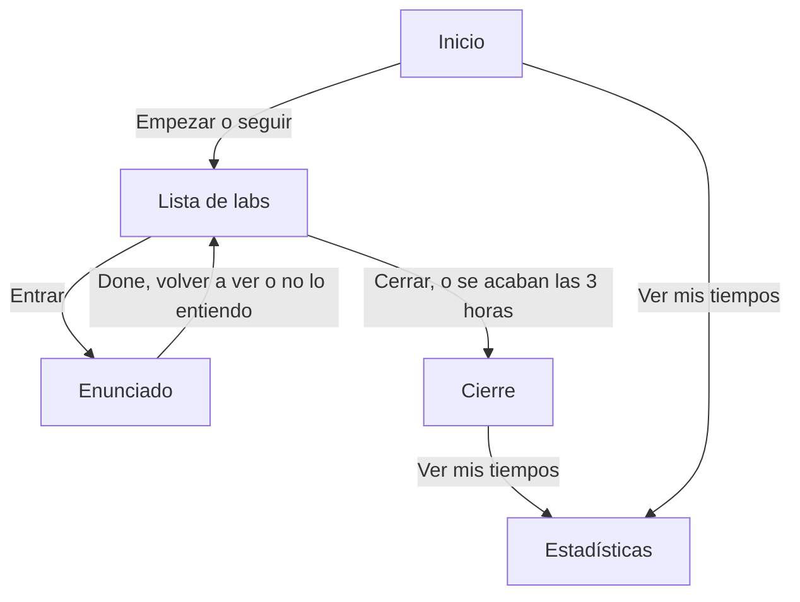
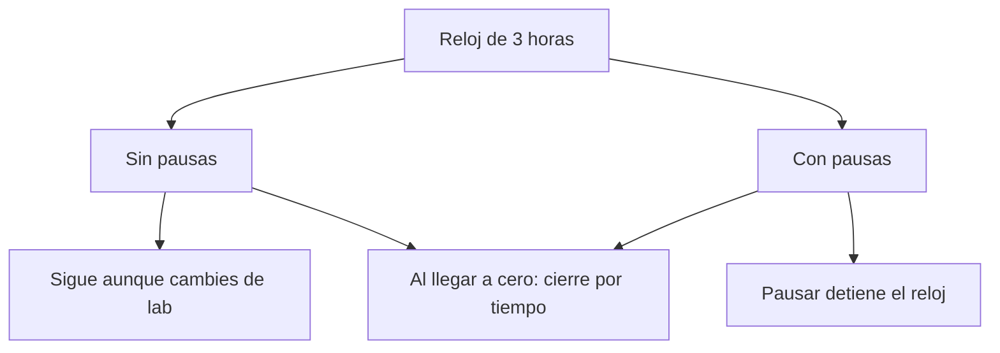

# Práctica personal para el examen RHCSA — arceprog

Práctica personal para el examen en [ex200-personal-practice.arceprog.dev](https://ex200-personal-practice.arceprog.dev). Un lab por vez, reloj de 3 horas y estadísticas en `localStorage` de este navegador.

```bash
npm install
npm run dev
```

El dev server usa el puerto **4322**.

Los enunciados salen de materiales públicos de práctica, adaptados al Vagrant de dos VMs (`client` `172.16.1.12`, `server` `172.16.1.13`) y a los nombres Felipe, Erik, Diego y Joaquin. La ayuda (comandos y videos) no aparece hasta apretar **Pedí ayuda**. Enlaces de apoyo: [lista de YouTube](https://www.youtube.com/playlist?list=PLzwsIhHG_OdZiC6ugglW4TzjIM8wrJDrt) y [repo del lab](https://github.com/nbaud/rhcsa_lab).

## Flujos

Cada caso anota qué quiere la persona, qué ve, qué hace y qué cambia en esa misma pantalla. El gráfico de temas vive en Estadísticas. Marcar un lab no lo muestra.



### Empezar

Quiere medir una práctica o retomar la que dejó. Ve la edición (10 o 9), dos modos y, si hay una en curso, **Seguí donde quedaste**.

| Acción | Qué cambia ahí |
|---|---|
| Empezar sin pausas | Entra a la lista. Reloj de 3 horas, sin botón de pausa. |
| Práctica con pausas | Entra a la lista. El reloj flotante tiene Pausa. |
| Seguí donde quedaste | Vuelve a la misma práctica. La edición del inicio no la reescribe. |
| Empezar otra, con una en curso | No se puede desde el inicio. Hay que cerrarla desde la lista. Si una quedó abandonada, en Estadísticas está Seguir esta. |

La edición 10 cuenta Flatpak y deja Podman afuera de lo pendiente. La 9 hace al revés. Elegirla en el inicio no cambia una práctica ya abierta.

### Hacer un lab

Quiere resolver el enunciado. Ve el título, los objetivos y el reloj. La ayuda no está.

| Acción | Qué cambia ahí |
|---|---|
| Entrar | Abre el enunciado y arranca el reloj de ese lab. |
| Pedí ayuda | Aparecen pasos, comandos y videos. El lab queda marcado con ayuda. |
| Done | Vuelve a la lista, tachado, y pide la dificultad. |
| Volver a ver | Vuelve a la lista, marcado para retomar. |
| No lo entiendo | Vuelve a la lista como pasado. No cuenta como hecho. |
| Rehacer | El reloj de ese lab vuelve a cero y suma un intento. Sigue en el enunciado. |
| Volver a la lista | El enunciado se cierra. El tiempo de la visita queda guardado. |
| Deshacer | Durante unos segundos se puede volver al estado anterior. |

En ese instante la pantalla no dice a qué tema sumó el lab. El gráfico, en Estadísticas, usa la mejor marca de todas las prácticas de ese modo, también la que está en curso.

### Reloj

Los dos modos tienen 3 horas. La pausa solo existe en el modo con pausas.



En sin pausas, una pista que el examen no muestra compite con el reloj y el enunciado. El gráfico de temas es esa pista si aparece en la lista o en el enunciado.

### Cerrar

Quiere saber cómo le fue. Ve el tiempo total, el recuento y cada lab con su marca. **Ver mis tiempos** lleva a Estadísticas. El gráfico no está en este cierre, que es cuando la pregunta pasa a ser qué tema falta.

### Estadísticas

Quiere comparar tiempos. Ve primero el gráfico de temas y después la mejora, la tabla por lab y el historial. Hay una pantalla para sin pausas y otra para con pausas.

El gráfico no dice qué lab lo movió. Para ver la causa hay que abrir el tema y leer la lista de labs. Quien acaba de marcar Apache tiene que salir de la práctica, entrar a Estadísticas y reconocer el tema SELinux y firewall.

### Decisiones

1. El gráfico responde la pregunta al cerrar la práctica y al elegir qué practicar antes de empezar. En Estadísticas la pregunta de esa pantalla es el tiempo.
2. En la lista y en el enunciado, sobre todo sin pausas, compite con el reloj y con el enunciado.
3. Al marcar, en la fila de ese lab: el tema y cómo quedó. Una línea. El gráfico completo no.
4. Sacar el gráfico de arriba de Estadísticas. El cierre es su lugar. En Estadísticas puede quedar, debajo de los tiempos, la lista corta de temas flojos.
